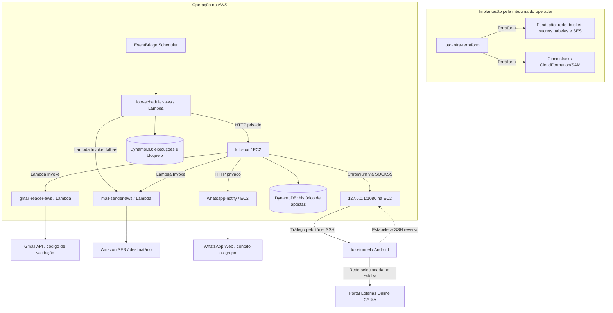
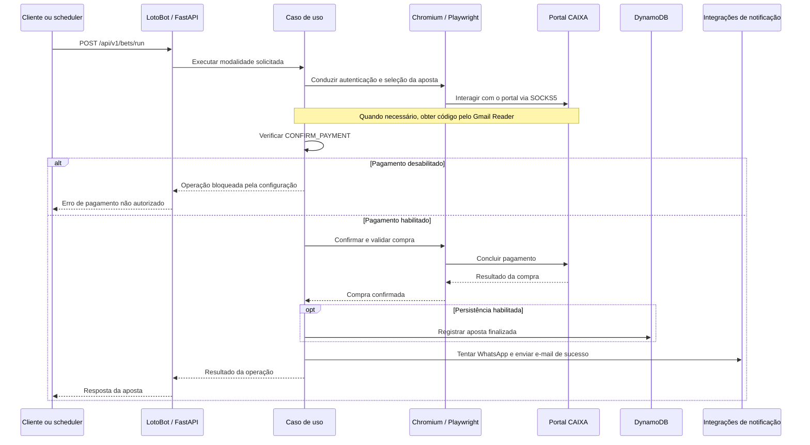
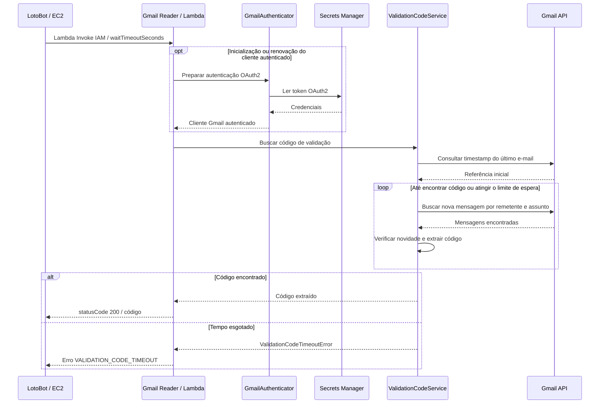
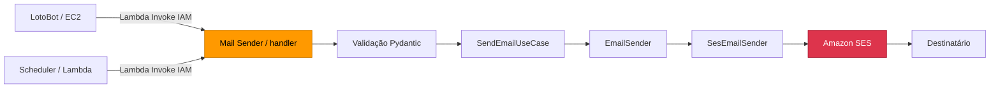
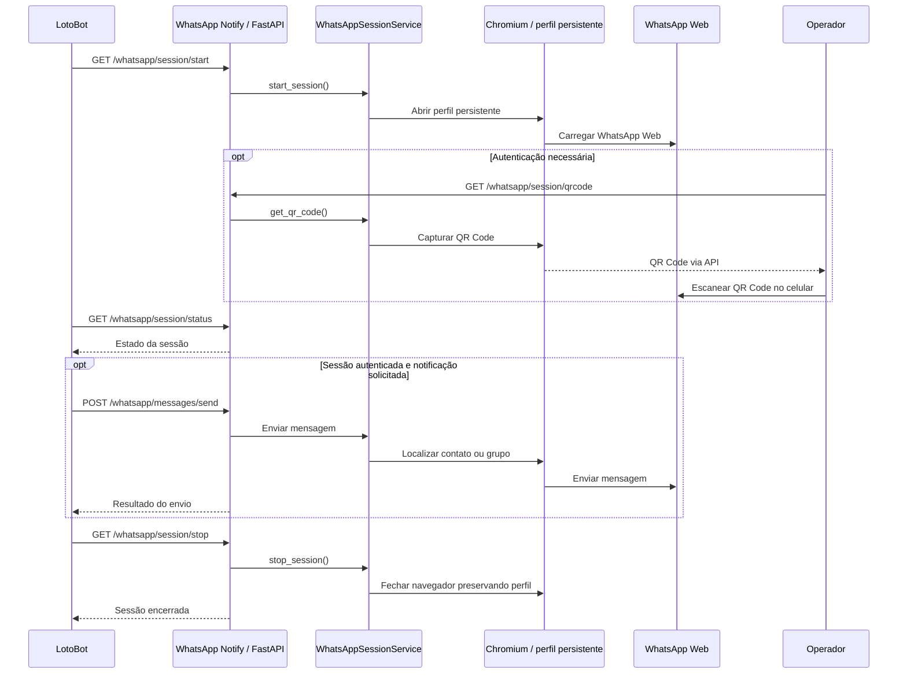

# LotoBot — sistema integrado e infraestrutura AWS

O sistema LotoBot automatiza operações no portal Loterias Online CAIXA: autenticação com código recebido por e-mail, execução do fluxo de apostas, consulta de apostas, armazenamento de histórico e conferência de resultados, com notificações por WhatsApp e e-mail. As operações podem ser solicitadas pela API ou pelos agendamentos configurados.

Este repositório, `loto-infra-terraform`, coordena a implantação na AWS de cinco aplicações e suas dependências. O sexto componente de execução, `loto-tunnel`, é um aplicativo Android instalado separadamente que fornece a saída de rede do navegador do bot. O deploy é executado localmente com Terraform, SAM e Ansible, sem GitHub Actions.

## Projetos e responsabilidades

Os links abaixo apontam para os repositórios irmãos, considerando todos os projetos no mesmo diretório `$HOME/projetos/`.

| Projeto | Objetivo e papel na integração | Execução no ambiente AWS |
|---|---|---|
| [loto-bot](../loto-bot/README.md) | Núcleo do sistema. Expõe API FastAPI, controla Chromium com Playwright, autentica no portal, executa apostas, consulta apostas e confere resultados. Usa Gmail Reader, Mail Sender e WhatsApp Notify | EC2 com Nginx; histórico em DynamoDB quando a persistência está habilitada |
| [gmail-reader-aws](../gmail-reader-aws/README.md) | Consulta a Gmail API com OAuth2, aguarda uma nova mensagem correspondente aos filtros e devolve o código de validação ao bot | Lambda invocada diretamente pelo bot com IAM; token OAuth no Secrets Manager |
| [mail-sender-aws](../mail-sender-aws/README.md) | Envia e-mails pelo Amazon SES. Atende notificações do bot e alertas de falha terminal do scheduler | Lambda invocada diretamente com IAM |
| [whatsapp-notify](../whatsapp-notify/README.md) | Expõe API para sessão do WhatsApp Web e envio a contatos ou grupos. Mantém perfil persistente do Chromium e depende de autenticação por QR Code quando necessária | EC2 com FastAPI, Playwright e Nginx; acesso do bot por HTTP privado |
| [loto-scheduler-aws](../loto-scheduler-aws/README.md) | Agenda `RUN_BET` e `CHECK_DRAWS`, controla a sessão remota, registra execuções e coordena acesso ao bot | EventBridge Scheduler aciona uma Lambda na VPC; controle em tabela DynamoDB própria |
| [loto-tunnel](../loto-tunnel/README.md) | Aplicativo Android em Kotlin/Compose. Abre um túnel SSH reverso e fornece um SOCKS5 na EC2, encaminhando os destinos pela rede Wi-Fi ou móvel selecionada no celular | Executado no celular; conecta por SSH à EC2 do bot e escuta remotamente em `127.0.0.1:1080` |
| **loto-infra-terraform** | Integra os templates dos cinco serviços, liga outputs e parâmetros entre stacks e organiza preparação, deploy, validação e reversão | Terraform na máquina do operador; fundação em state separado e atualização de código EC2 por Ansible |

## Como os componentes se comunicam

O diagrama representa o ambiente AWS e o caminho de saída do navegador. As setas de deploy estão separadas das chamadas durante a operação.

### Fluxo de uma execução

1. **Disparo:** um cliente chama a API do bot ou o EventBridge Scheduler aciona a Lambda do scheduler no horário configurado. `RUN_BET` chama `POST /api/v1/bets/run`; `CHECK_DRAWS` chama `POST /api/v1/bets/check_draws`.
2. **Coordenação:** no caminho agendado, o scheduler consulta e reconcilia a sessão, adquire o bloqueio no DynamoDB e gerencia abertura e encerramento da sessão que adquiriu. Seu código consome os contratos HTTP do bot, sem importar os projetos irmãos.
3. **Navegação e autenticação:** o bot controla o Chromium. No template AWS, o navegador usa `socks5://127.0.0.1:1080`. Quando precisa do código de validação, o bot invoca o Gmail Reader, que consulta a Gmail API com o token OAuth armazenado no Secrets Manager.
4. **Operação:** o bot executa o fluxo solicitado no portal. A confirmação real de pagamento depende de `CONFIRM_PAYMENT`; a configuração inicial gerada por este projeto mantém `ConfirmPayment=false`. Apostas finalizadas podem ser persistidas na tabela de histórico; a conferência correlaciona histórico e informações do portal.
5. **Notificação:** para falhas e conferência de resultados, o bot tenta WhatsApp quando habilitado e disponível, com e-mail como alternativa. Para uma aposta finalizada com sucesso, tenta WhatsApp e também tenta enviar e-mail, independentemente do resultado do WhatsApp. O scheduler usa Mail Sender para comunicar falhas terminais da execução agendada.
6. **Registro e encerramento:** o scheduler registra o resultado na tabela de execuções e trata a sessão e o bloqueio conforme o desfecho. Essa tabela é diferente da tabela de histórico de apostas do bot.

As Lambdas de Gmail e e-mail usam invocação direta autorizada por IAM; seus templates não publicam API Gateway ou Function URL. O HTTP privado entre scheduler, bot e WhatsApp depende da VPC, dos Security Groups e dos endereços ligados pelo Terraform.

## Diagramas dos fluxos integrados

Os diagramas abaixo adaptam as visões dos READMEs de [loto-bot](../loto-bot/README.md), [gmail-reader-aws](../gmail-reader-aws/README.md), [mail-sender-aws](../mail-sender-aws/README.md) e [whatsapp-notify](../whatsapp-notify/README.md) para este ambiente AWS.

### Execução de uma aposta pelo LotoBot

Visão simplificada do fluxo principal, com a sessão preparada pelo cliente ou scheduler. A navegação no portal usa o proxy descrito na seção do túnel.

### Obtenção do código pelo Gmail Reader

O Gmail Reader busca uma mensagem nova em relação ao início da consulta, filtrada por remetente e assunto. O tempo de espera é limitado a 15 segundos; um código já presente antes da chamada não atende a esse fluxo.

### Envio de e-mail pelo Mail Sender

O bot e o scheduler usam a mesma Lambda de envio, por invocação direta com IAM. O handler valida a entrada antes de encaminhá-la ao caso de uso e ao Amazon SES.

No bot, o e-mail atende o fallback de falhas e conferências e também é tentado nas notificações de sucesso. No scheduler, comunica falhas terminais. O remetente precisa estar verificado no SES; no sandbox, o destinatário também precisa de verificação.

### Sessão e envio pelo WhatsApp Notify

O bot controla a sessão por HTTP privado. Quando a autenticação é necessária, o operador obtém o QR Code pela API e o escaneia no celular; o perfil persistente permite reutilizar a autenticação nas sessões seguintes.

## Papel do túnel Android

O `loto-tunnel` inicia a conexão SSH com a EC2 e solicita o encaminhamento reverso para o loopback remoto. Quando o navegador usa esse SOCKS5, o aplicativo abre o destino pela rede selecionada do celular. Isso permite que a navegação do bot saia pela conexão do aparelho; o túnel não transporta automaticamente todas as integrações AWS ou o tráfego do WhatsApp Notify.

O aplicativo não recebe credenciais AWS nem descobre a EC2: host, usuário, chave SSH e confiança na identidade do servidor são configurados separadamente. A porta SOCKS5 permanece restrita a `127.0.0.1`; o acesso SSH deve permitir a origem atual do celular. A disponibilidade do túnel depende do aparelho, da rede e da sessão SSH.

Este repositório também fornece [examples/loto-socks.service](examples/loto-socks.service), uma alternativa de túnel reverso pelo computador Linux. Escolha o aplicativo Android ou o serviço local para fornecer o proxy na porta configurada; dois túneis não podem ocupar simultaneamente `127.0.0.1:1080`. A instalação do APK e a manutenção da conexão no celular são separadas do deploy Terraform.

## Dados e limites da automação

No modo `AWS`, o bot usa DynamoDB; no modo `LOCAL`, oferece integração HTTP com serviços locais e persistência MongoDB. O fluxo deste repositório prepara o ambiente AWS. A fundação cria os contêineres dos secrets, mas seus valores são preenchidos fora do Terraform.

Os dois agendamentos começam `DISABLED`, com `scheduler_paused=true` na instalação nova. A pausa impede novos disparos, mas não cancela execuções já entregues. Libere os agendamentos somente após validar aplicações, autenticações e túnel conforme [EXECUCAO.md](EXECUCAO.md).

O scheduler usa deduplicação por job e horário, além de um bloqueio compartilhado para serializar operações que usam a mesma tabela. Isso não garante execução única da aposta: tentativas após uma resposta incerta podem repetir uma compra, pois o bot não oferece idempotência por `X-Correlation-ID`. Não mantenha outro scheduler ativo para o mesmo bot; o bloqueio AWS não coordena um agendador local. Sessões do portal e do WhatsApp, validade do OAuth e mudanças nos sites externos também exigem acompanhamento operacional.

## Decisão de implementação

Esta primeira versão usa **Terraform + CloudFormation/SAM + Ansible**. Não é uma conversão dos recursos para Terraform nativo: Terraform administra as stacks por `aws_cloudformation_stack`; CloudFormation continua responsável por suas EC2, IAM e Lambdas. Isso permite importar as stacks já implantadas e aproveitar seus templates e verificações.

SAM compila e publica pacotes Lambda, sem executar `sam deploy`. Ansible atualiza o código das EC2 existentes e verifica Nginx/API, porque atualizar UserData não reinstala automaticamente a aplicação. A configuração inicial continua nos templates dos repositórios. O scheduler usa o IP privado atual e o Security Group do bot e o ARN do mail-sender, ligados pelo Terraform. Os parâmetros de rede do scheduler devem apontar para a mesma VPC e subnets com acesso privado ao bot e aos serviços AWS.

| Componente | Responsável |
|---|---|
| Stacks e dependências entre as cinco aplicações | Terraform |
| Recursos dentro de cada stack e bootstrap EC2 | Templates CloudFormation existentes |
| Build Lambda e upload S3 | SAM CLI |
| Atualização do código EC2, troca de release e recuperação | Ansible |
| Rede, endpoints, bucket, chave pública SSH, contêineres dos secrets, SES e tabelas | Terraform separado em `foundation/` para instalação do zero |
| Scheduler | Stack gerenciada pelo Terraform; pausa de manutenção com `scheduler_paused` |
| Tabela de execuções do scheduler | Gerenciada pela fundação, preservada durante deploy e rollback das aplicações |
| Túnel SOCKS | Aplicativo Android `loto-tunnel` ou serviço SSH local, configurado separadamente do deploy |

**Comece por [INSTALACAO.md](INSTALACAO.md), depois [EXECUCAO.md](EXECUCAO.md).** Consulte [OPERACAO.md](OPERACAO.md) para reversão de versão, state e limitações, e [ROLLBACK.md](ROLLBACK.md) para desmontar completamente o ambiente AWS.

Para entender os comandos antes de executar o roteiro, consulte o [tutorial simples de Terraform](TUTORIAL-TERRAFORM.md), com exemplos específicos deste projeto.

Nenhum comando de deploy roda ao abrir o projeto. A preparação envia artefatos ao S3; `terraform apply` e `ansible-playbook` são etapas explícitas.

## Arquivos

- `*.tf`: provider, cinco stacks e outputs.
- `foundation/`: infraestrutura básica, com state independente das aplicações.
- `FUNDACAO.md`: criação do ambiente vazio e configuração dos secrets/SES.
- `ROLLBACK.md`: desmontagem definitiva das aplicações e da fundação, com tratamento dos dados e recursos restantes.
- `scripts/configure-new.sh`: gera a configuração inicial a partir dos outputs da fundação.
- `scripts/plan-foundation.sh`: restaura/importa secrets existentes antes de planejar a fundação; cria as ausentes no apply.
- `scripts/adopt.sh`: captura configuração atual e importa stacks.
- `scripts/prepare.sh`: build e upload das releases.
- `scripts/inventory.sh`: inventário IPv6 e integridade dos ZIPs.
- `scripts/check.sh`: valida APIs diretamente e via Nginx, comunicação bot → WhatsApp e scheduler; a validação SOCKS é uma etapa separada do roteiro de execução.
- `scripts/check-scheduler.sh`: confere Lambda, tabela e estados dos agendamentos sem executar jobs.
- `ansible/deploy.yml`: atualização das EC2 preservando `data/` e `/etc/*.env`.
- `examples/`: parâmetros e serviço local para o túnel.
- `prepared/`: templates reais exportados ou empacotados; gerados localmente.
- `tests/run.sh`: testes locais da integração com CLIs e provider simulados.

O state e os arquivos gerados contêm identificadores e podem conter e-mails/parâmetros sensíveis. `sensitive` esconde a saída normal, mas não criptografa state. Eles estão no `.gitignore`; mantenha backup protegido. Não adicione chaves, tokens OAuth, perfis de navegador ou dados de cartão aos repositórios.
